# Shutdown mode

These screenshots show the local web app with shutdown mode off and on. The signed-in views use a demo account with zero tokens. Select an image for the full-size screenshot.

| Section | Mode off | Mode on |
| --- | --- | --- |
| Sign-in and signup | [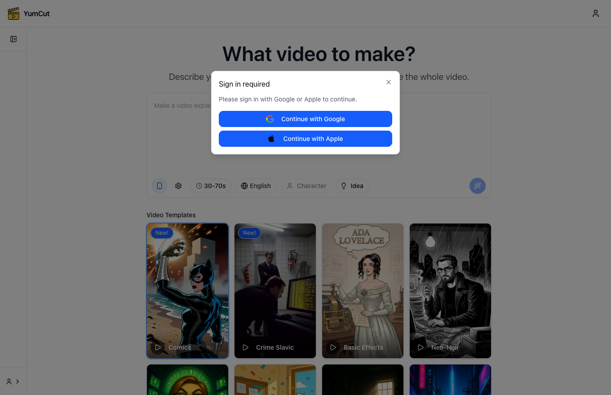](signin-before.png) | [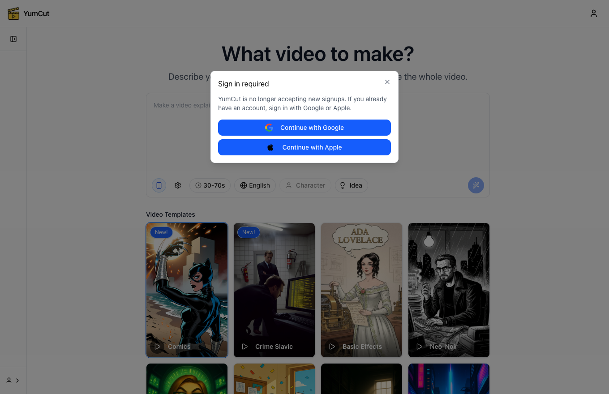](signin-after.png) |
| Signed-in workspace | [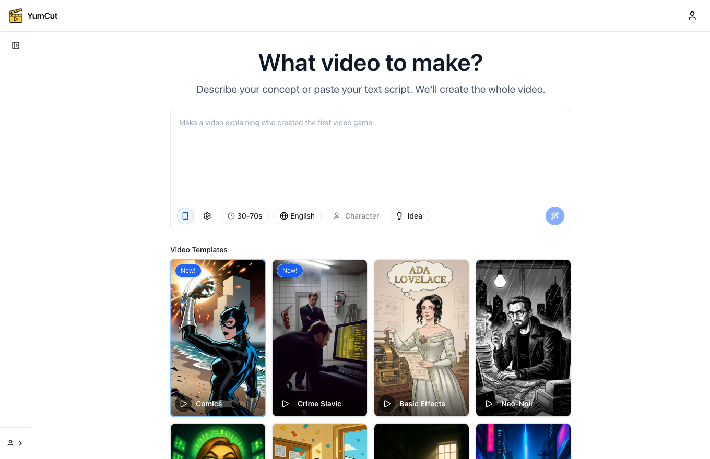](workspace-before.png) | [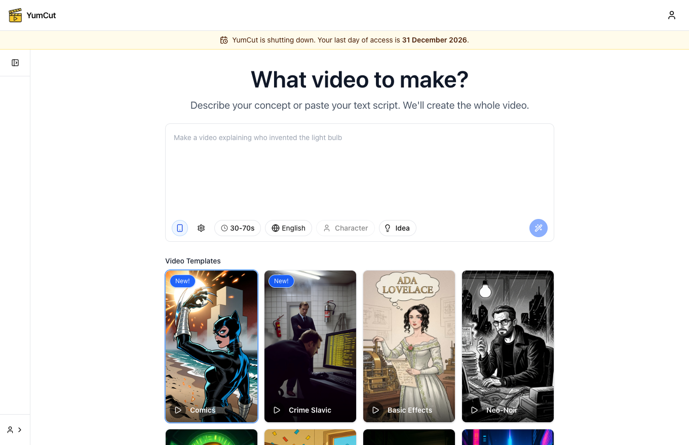](workspace-after.png) |
| Account billing | [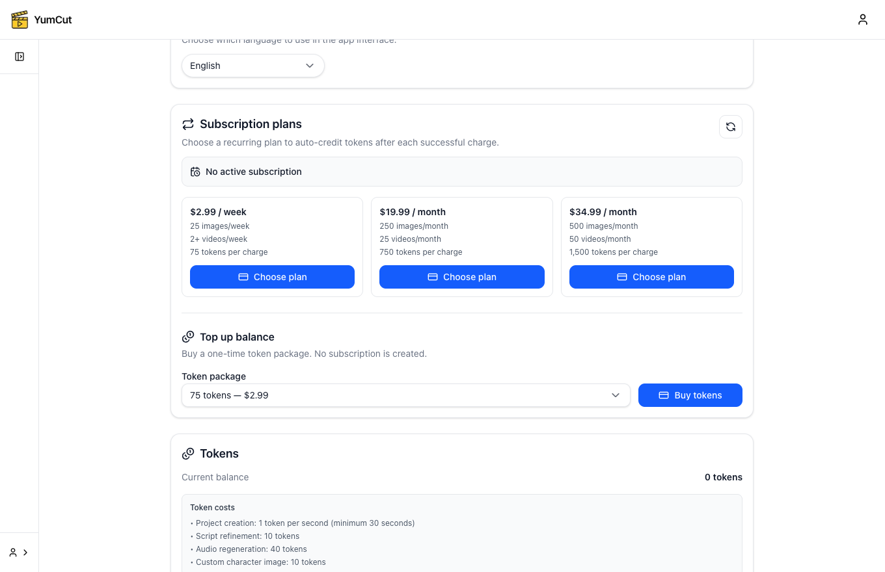](account-before.png) | [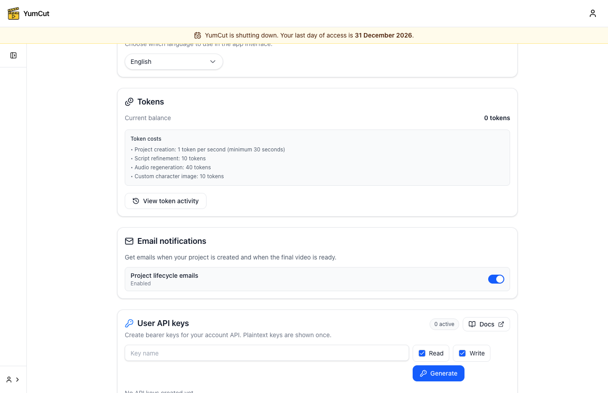](account-after.png) |
| Story creation | [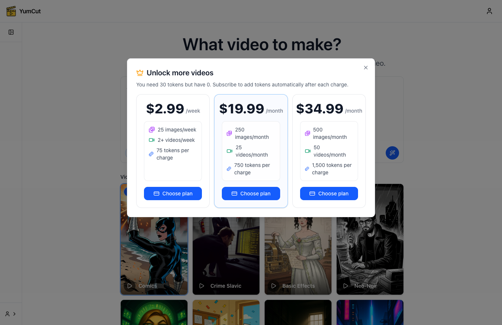](story-before.png) | [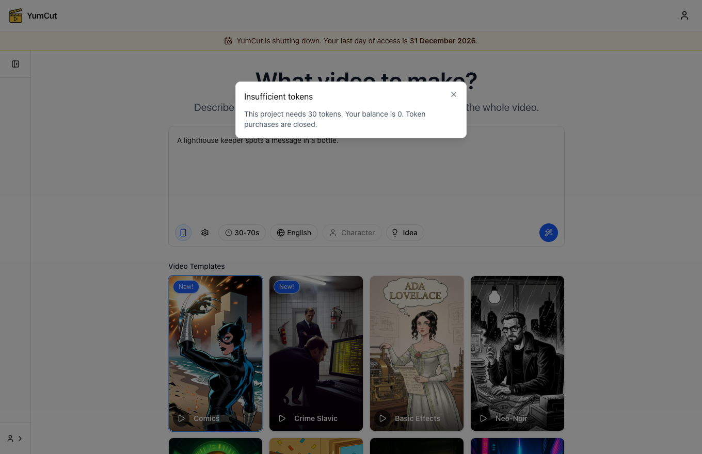](story-after.png) |
| Character video creation | [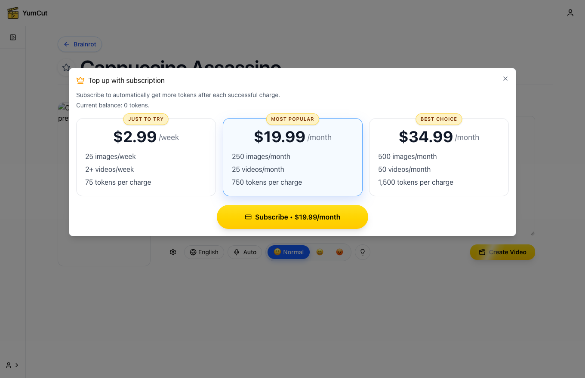](character-before.png) | [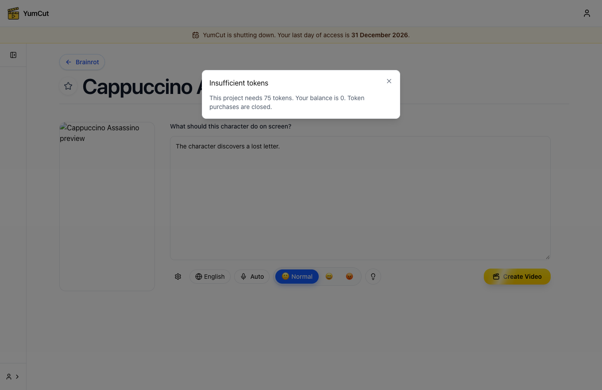](character-after.png) |
| Image Prank creation | [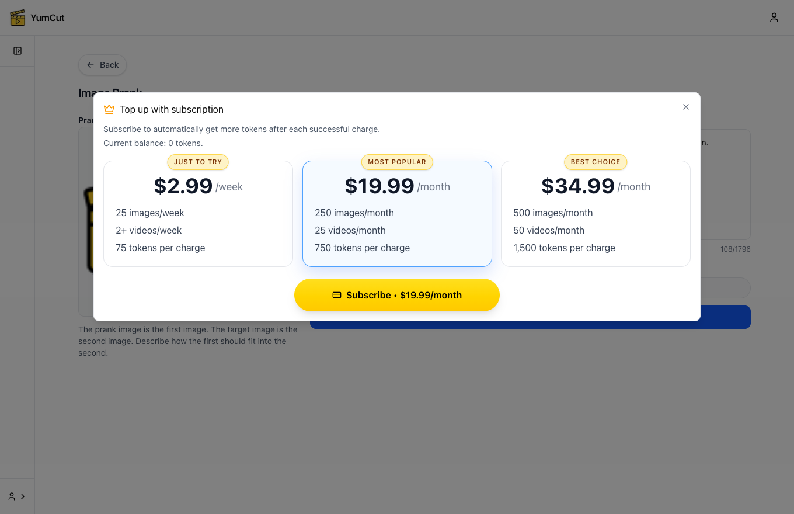](prank-before.png) | [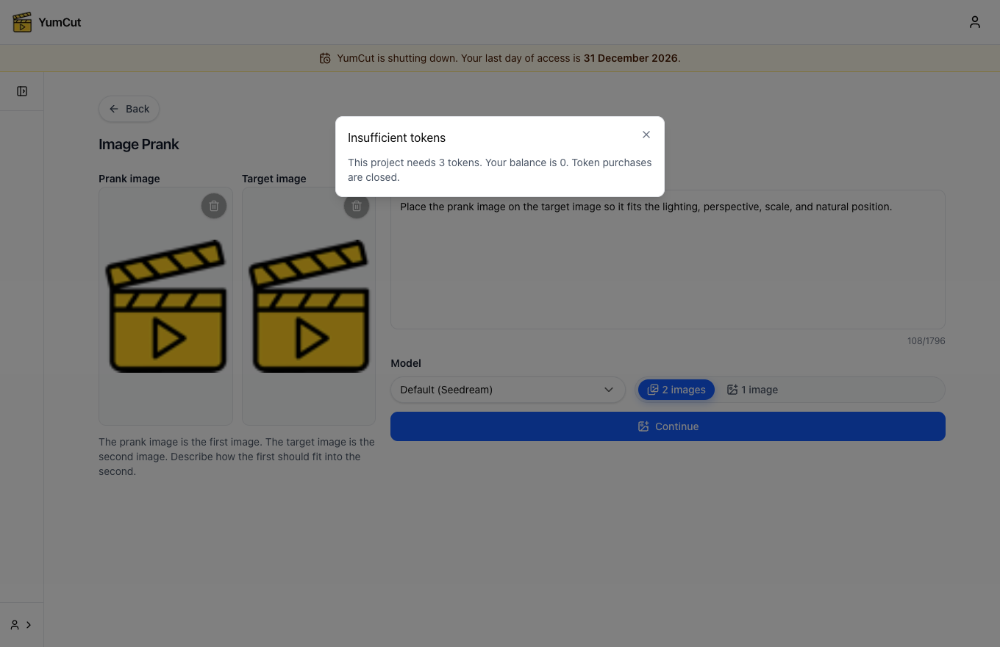](prank-after.png) |
| Russian low-balance notice | [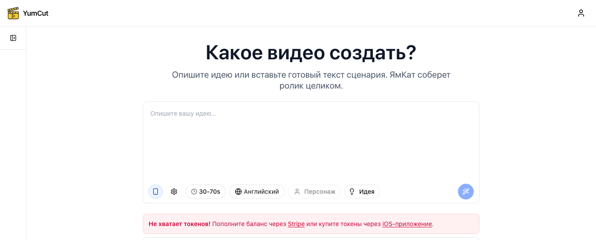](low-balance-before.png) | [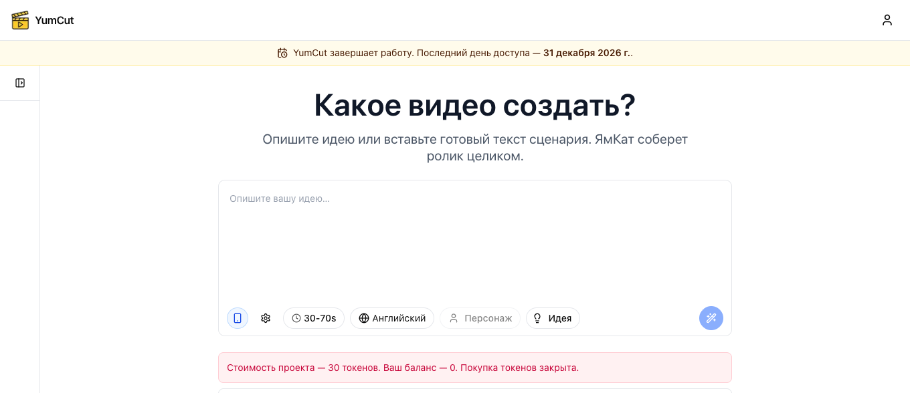](low-balance-after.png) |
